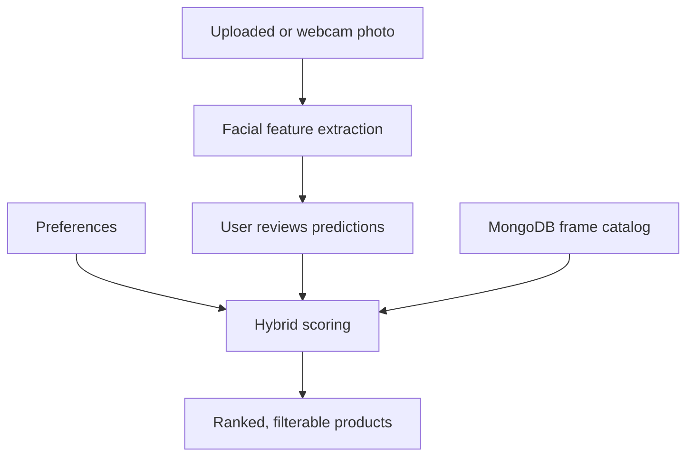

# AI-Based Eyeglass Frame Recommendation System

A full-stack web application that helps customers discover suitable eyeglass frames using **computer vision**, **expert-defined matching rules**, and **personal preferences**. The application analyzes a face photo, allows users to correct the detected attributes, and ranks products from an eyewear catalog.

Developed as an engineering thesis project: *Aplikacja webowa wspomagająca dobór oprawek okularowych* (Web Application Supporting Eyeglass Frame Selection).

## Overview

Eyeglass selection is influenced by facial proportions as well as personal taste. This project combines machine-learning predictions with geometric facial measurements and eyewear-selection rules in a **hybrid recommendation engine**. Its potential commercial use is an AI shopping assistant that helps customers and optical retailers narrow a product catalog to relevant frames.

### Features

- **Facial analysis:** predict face shape and eyebrow shape; estimate eye spacing from landmarks.
- **Camera or upload:** take a webcam photo or provide an existing image.
- **Human-in-the-loop review:** inspect landmark visualizations and correct all three predicted attributes before ranking.
- **Configurable personalization:** choose frame shapes, materials, colors, and brands; adjust the balance between AI advice and personal choices.
- **Catalog integration:** query products and available attributes from MongoDB Atlas.
- **Ranked recommendations:** display a compatibility score for each frame, with pagination and filters for shape, material, color, and price.

## Application workflow



1. The user selects their preferred frame characteristics and the AI influence percentage.
2. The application obtains a facial photograph.
3. The backend detects face shape, eyebrow shape, and relative eye spacing.
4. The user reviews the results and can correct any prediction.
5. Rules map the confirmed facial attributes to suitable frame shapes and materials.
6. The recommendation engine scores every catalog item and returns a descending ranking; the UI supports further filtering.

## Computer vision and machine learning

| Task | Technique | Classes / result |
| --- | --- | --- |
| Face shape | **EfficientNet-B4** (PyTorch/torchvision), adapted with transfer learning | `heart`, `oblong`, `oval`, `round`, `square` |
| Eyebrow shape | **dlib 68-point landmarks**, 12 geometric angle features, **TensorFlow/Keras MLP** | `straight`, `high_arch`, `round` |
| Eye spacing | **MediaPipe Face Mesh**, relative eye-width geometry | `narrow`, `balanced`, `wide` |

### Face-shape classification

The five-class EfficientNet-B4 model processes RGB images resized to **224 × 224**. The training code includes horizontal flips, rotations, color jitter, ImageNet normalization, a dropout classification head, AdamW, cross-entropy with label smoothing, mixed-precision training, and selection of a checkpoint based on validation loss.

Source: [`training_face_shape.py`](backend/model/training_face_shape.py) and [`prediction_face_shape.py`](backend/model/prediction_face_shape.py). The original training script contains Google Colab-specific commands and paths.

### Eyebrow classification

dlib locates facial landmarks and extracts **six angles per eyebrow**. These 12 measurements are standardized and classified by a feed-forward neural network:

`12 features → Dense(64, ReLU) → Dense(32, ReLU) → Dense(3, Softmax)`

Training includes a stratified train/test split, feature scaling, label encoding, and checkpoint saving. The repository includes the feature CSV and source code for dataset creation, training, and inference.

Source: [`create_dataset_brows.py`](backend/model/create_dataset_brows.py), [`train_nn_brows.py`](backend/model/train_nn_brows.py), and [`prediction_brows.py`](backend/model/prediction_brows.py).

### Eye-spacing estimation

The MediaPipe module uses landmarks **33, 133, 362, and 263** to estimate eye widths and the gap between the inner corners:

$$
r = \frac{\text{distance between inner eye corners}}{\text{average width of the two eyes}}
$$

| Ratio | Classification |
| --- | --- |
| $r < 1.0$ | Narrow |
| $1.0 \le r \le 1.2$ | Balanced |
| $r > 1.2$ | Wide |

This is a relative geometric estimate, **not** a medical pupillary-distance measurement.

Source: [`eye_distance.py`](backend/model/eye_distance.py).

## Hybrid recommendation engine

Recommendations combine three signals:

- **$S$ — AI-guided fit:** domain rules map face and eyebrow shape to suitable frame shapes, and eye spacing to weighted frame-material preferences.
- **$U$ — explicit user choices:** rewards frames matching the customer's selected shape and material.
- **$P$ — additional preferences:** weighted bonuses for selected frame colors and brands.

The implemented score is:

$$
\boxed{R = 0.7\left[(1-\alpha)U + \alpha S\right] + P}
$$

where $\alpha\in[0,1]$ is the AI-influence slider (default **0.5**), $S\le1$, $U\le0.8$, and $0\le P\le0.3$.

The current rules assign:

- **AI shape fit:** $0.4 \times$ the matching shape-rule weight (1.0 for one rule, 1.5 if face and eyebrow rules agree).
- **AI material fit:** $0.4 \times (w/5)$ for a matching material, with rule weight $w$.
- **User fit:** +0.4 for a selected frame shape and +0.4 for a selected material.
- **Color/brand bonus:** proportional to the user's importance settings and capped at 0.3 in total.

The resulting scores sort the catalog in descending order. The displayed **compatibility percentage is a heuristic ranking score**, not a calibrated probability. **Price is currently used for filtering, not scoring.**

Source: [`fit_frames_prediction.py`](backend/model/fit_frames_prediction.py) and [`routes/user.py`](backend/routes/user.py).

## Technology stack

| Layer | Technologies |
| --- | --- |
| Frontend | React 19, JavaScript, Vite, Tailwind CSS, React Router, Framer Motion |
| REST API | Python, FastAPI, Uvicorn |
| Database | MongoDB Atlas, Motor (asynchronous client) |
| Face-shape model | PyTorch, torchvision, EfficientNet-B4 |
| Eyebrow model | TensorFlow/Keras, scikit-learn, dlib |
| Image and landmark processing | MediaPipe, OpenCV, NumPy, Pillow |

## Repository structure

```text
.
├── src/
│   ├── Pages/                       # Preferences, camera, correction, ranking
│   ├── Components/                  # Webcam, uploader, filters, frame cards
│   ├── utils/                       # Frontend helpers
│   └── public/                      # Frame images and analysis visualizations
├── backend/
│   ├── index.py                     # FastAPI setup
│   ├── db.py                        # MongoDB connection
│   ├── routes/
│   │   ├── frames.py                # Catalog metadata
│   │   ├── fixing.py                # Photo analysis
│   │   └── user.py                  # Recommendations
│   ├── model/
│   │   ├── training_face_shape.py
│   │   ├── prediction_face_shape.py
│   │   ├── create_dataset_brows.py
│   │   ├── train_nn_brows.py
│   │   ├── prediction_brows.py
│   │   ├── eye_distance.py
│   │   └── fit_frames_prediction.py
│   └── requirements/               # API dependency manifests
├── package.json
└── vite.config.js
```

## API

| Method | Route | Description |
| --- | --- | --- |
| `GET` | `/frames` | Returns distinct shapes, colors, materials, and brands from MongoDB. |
| `POST` | `/fixing` | Accepts multipart field `photo`; returns `[eye_spacing, face_shape, brows_shape]`. |
| `POST` | `/user` | Accepts user preferences and confirmed facial attributes; returns `{ "recommendation": [...] }`, sorted by score. |

The frontend constructs the `/user` request as a JSON array containing **(1)** preferences, **(2)** preference-importance values, and **(3)** confirmed facial attributes. FastAPI serves API documentation at `/docs` when running.

Frame records use fields including `_id`, `name`, `mark` (brand), `shape`, `type` (material), `color`, `price`, and `img`.

## Local development

> **Important:** This repository is a thesis/development snapshot, not a turnkey deployment. The backend still contains machine-specific Windows paths and a few configuration issues. Follow the setup notes before starting it.

### Requirements

- Node.js and npm.
- Python with versions of PyTorch, TensorFlow, MediaPipe, and dlib compatible with your platform.
- MongoDB with an eyewear collection (the current code uses database `ZPI`, collection `frames`).
- Saved classifiers, preprocessing artifacts, and the dlib landmark predictor.

**The training and inference source code is included, but trained model artifact files (`.pth`, `.h5`, `.pkl`, `.dat`) are not committed.** The inference paths expect these under `backend/model/models/`:

```text
best_model.pth
brows_model.h5
label_encoder_brows.pkl
scaler_brows.pkl
shape_predictor_68_face_landmarks.dat
```

### Frontend

```bash
git clone --branch fastAPI-branch https://github.com/Chillmav/ai-eyewear-recommender.git
cd ai-eyewear-recommender
npm install
npm run dev
```

Vite normally serves the frontend at `http://localhost:5173`. The frontend currently sends API requests to `http://localhost:8000`.

### Backend

Create a Python environment and install the API requirements:

```powershell
python -m venv .venv
.\.venv\Scripts\Activate.ps1
pip install -r backend/requirements/requirements.txt
```

Install the additional ML dependencies used by `backend/model/`: PyTorch/torchvision, TensorFlow/Keras, dlib, MediaPipe, OpenCV, scikit-learn, NumPy, Pillow, and `python-multipart`. The API and ML requirements are currently separate and have **not** been verified together as a reproducible cross-platform environment. dlib may need platform-specific installation steps.

Before starting the API:

1. **Rotate any previously exposed MongoDB credentials.** Replace the hard-coded connection string in `backend/db.py` with a securely supplied environment variable. Merely adding a `.env` file will not help until the code reads it.
2. Update the absolute model, photo, and visualization paths in the Python files to locations on your machine.
3. Create the required photo-output directories and configure the FastAPI static `/public` mount.
4. Correct the undefined `router` decorator in `backend/db.py`, and ensure your MongoDB catalog and product images are available.

Then, from the `backend` directory:

```bash
cd backend
uvicorn index:app --reload
```

The API is expected at `http://localhost:8000`, with interactive documentation at `http://localhost:8000/docs`.

## Limitations and next steps

- Recommendations support **aesthetic discovery**, not professional optical fitting or clinical measurements.
- Rule weights and compatibility percentages are heuristic and have not been calibrated against real customer outcomes.
- Training scripts and eyebrow feature data are included, but the repository does not include trained weights, published evaluation reports, or automated end-to-end tests.
- The backend needs environment-based configuration, path portability, input validation, and deployment/security hardening before public hosting.
- Further retail features could include real-time inventory integration, frame dimensions, customer feedback, and learning-to-rank from interaction data.

## Retail use case

As an **AI-powered shopping assistant for optical stores**, the project demonstrates how a customer photo and stated preferences can be transformed into an explainable shortlist of relevant eyewear products. Customers retain control over the result, while retailers can use the ranked catalog to support personalized product discovery.

## Author

**Jakub Kulig** · Engineering thesis project · [GitHub](https://github.com/Chillmav)
